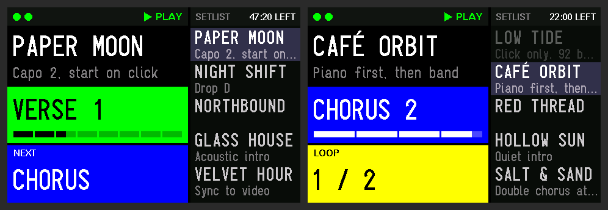
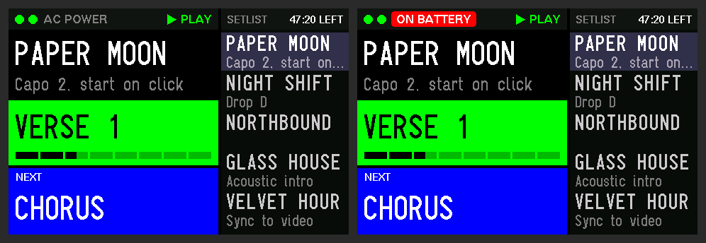
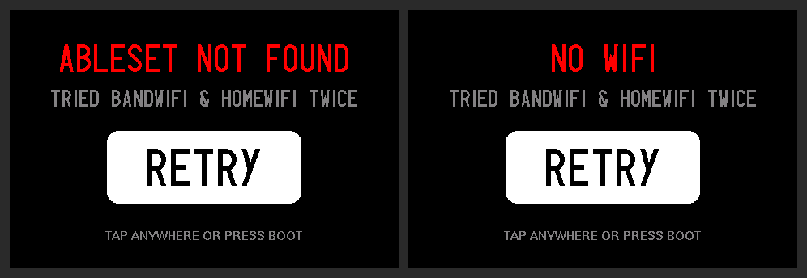
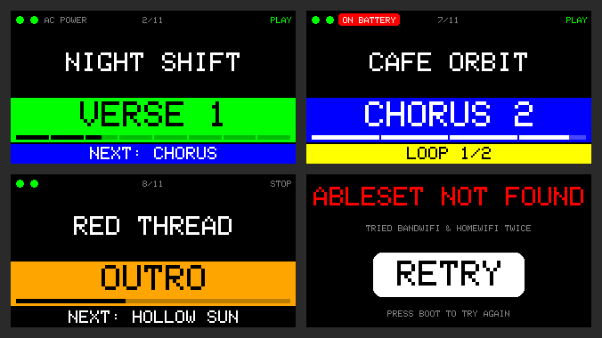

# AbleSet stage display (ESP32-C5)

Small Wi-Fi stage displays for [AbleSet](https://ableset.app): they show the current song, the current section in its AbleSet colour, and what's coming next, so the band doesn't have to look at the laptop.

They use the **ESP32-C5**, the first ESP32 with **5 GHz Wi-Fi**, so they keep working on crowded stages where 2.4 GHz is saturated.

Two versions:

| | [ESP32-C5-LCD-1.47](esp32-c5-lcd-1.47) | [ESP32-C5-Touch-LCD-3.5](esp32-c5-touch-lcd-3.5) |
|---|---|---|
| Screen | 1.47" 320×172 | 3.5" 480×320, touch, in a case |
| Shows | Song, section with progress strip, next section / next song, loop counter, laptop power state | Same, plus the setlist with time left |
| Board | [Waveshare ESP32-C5-LCD-1.47](https://www.waveshare.com/esp32-c5-lcd-1.47.htm) | [Waveshare ESP32-C5-Touch-LCD-3.5](https://www.waveshare.com/esp32-c5-touch-lcd-3.5.htm) |

## Screenshots

### 3.5" version (480×320)

Playing, then inside a 4-bar loop:

Laptop power state in the status bar:

Retry screen, after AbleSet or the Wi-Fi could not be found:

### 1.47" version (320×172)

Shown at actual pixel size. Playing, inside a loop with the laptop on battery, stopped on an outro with the next song, and the retry screen:

## How it works

The display joins your Wi-Fi, finds AbleSet on the network on its own (no IP address to type), and subscribes to AbleSet's [OSC updates](https://ableset.com/docs/osc). It needs AbleSet Standard or Pro, with the display and the AbleSet computer on the same network.

- **Several networks:** list as many as you like (rehearsal room, venue, home). If AbleSet isn't found on one, it tries the next.
- **Section colours** come straight from AbleSet, made more vivid for stage lighting.
- **Loops:** the next-section cell turns into a loop counter (`LOOP 2 / 4`).
- **Self-healing:** if an update is missed, the display re-syncs with AbleSet every few seconds. OSC is received in a background task, so redrawing the screen never makes it miss packets.
- **Section progress bar:** one segment per bar, filling beat by beat, so you can see where you are in a loop.
- **Laptop power warning:** a red `ON BATTERY` badge if the AbleSet computer gets unplugged.
- **Retry screen:** after two passes through all networks without finding AbleSet, it stops and waits. Press BOOT (or tap the screen on the 3.5") to try again.
- **Clean names:** tags in braces such as `{Drop}` are hidden.

### 3.5" version only

- **Setlist** on the right, with the time left in the set.
- Accented names display as-is (the 1.47" uses a built-in font, so `é` shows as `E`).

## Setup

### 1. Arduino IDE

- Boards Manager: **esp32 by Espressif Systems, version 3.3.10.** Waveshare tested these boards on 3.3.10; other versions may fail to flash.
- Library Manager:
  - **GFX Library for Arduino** (moononournation), 1.6.x
  - **U8g2** (olikraus), 3.5" version only, for its fonts

### 2. Your Wi-Fi networks

In the sketch folder, copy `secrets.example.h` to `secrets.h` and fill in your networks. `secrets.h` is in `.gitignore`, so your passwords stay on your machine.

### 3. Board settings (Tools menu)

| Setting | 1.47" | 3.5" |
|---|---|---|
| Board | ESP32C5 Dev Module | ESP32C5 Dev Module |
| USB CDC On Boot | Enabled | Enabled |
| PSRAM | — | **Enabled** |
| Partition Scheme | Default | **Huge APP** (or *Minimal SPIFFS*) |

### 4. Upload

If the upload can't connect, put the board in download mode: hold **BOOT**, press and release **RST** (or unplug and replug), then release **BOOT**.

If it still can't connect, plug the board into a port on the computer itself or a simple hub. Deep chains of USB hubs (monitor hubs, some docks) can prevent flashing over the ESP32-C5's built-in USB.

## Options

Each sketch has a config block at the top. The most useful settings:

| Setting | What it does |
|---|---|
| `ABLESET_HOST` | Leave empty for auto-discovery, or set AbleSet's IP address |
| `DEVICE_NAME` | Name shown in AbleSet's device list |
| `LOOP_COUNTER_OFFSET` | Set to 1 if the first pass of a loop shows `LOOP 0` |
| `BAND_SATURATION`, `BAND_BRIGHTNESS` | How vivid the section colours are |
| `ROTATION` | 3.5" only: screen orientation (1 or 3) |
| `PROGRESS_BY_BEAT` | `false` lights whole bars instead of filling beat by beat |
| `SHOW_PROGRESS` | 1.47" only: `false` hides the progress strip |
| `WIFI_ROUNDS` | Passes through the network list before showing Retry |
| `USE_RGB_LED` | 1.47" only: status colour on the on-board LED |
| `LEFT_FONT`, `SIDE_FONT` | 3.5" only: text sizes |

## Troubleshooting

Open the Serial Monitor at **115200** baud. The display logs the networks it sees, which one it joined, when it finds AbleSet, and the setlist it received.

## Working on the code

[CLAUDE.md](CLAUDE.md) has the architecture notes, hardware details and build commands, for people and for coding assistants like Claude Code.

## Credits

- [AbleSet](https://ableset.app) by Léo Bernard: the setlist manager this talks to
- [GFX Library for Arduino](https://github.com/moononournation/Arduino_GFX) by moononournation
- [U8g2](https://github.com/olikraus/u8g2) by olikraus: fonts (Logisoso)
- Waveshare's [example code](https://github.com/waveshareteam/ESP32-C5-Touch-LCD-3.5) for the 3.5" board's I/O expander sequence

This project isn't affiliated with AbleSet.

## Licence

[MIT](LICENSE)
